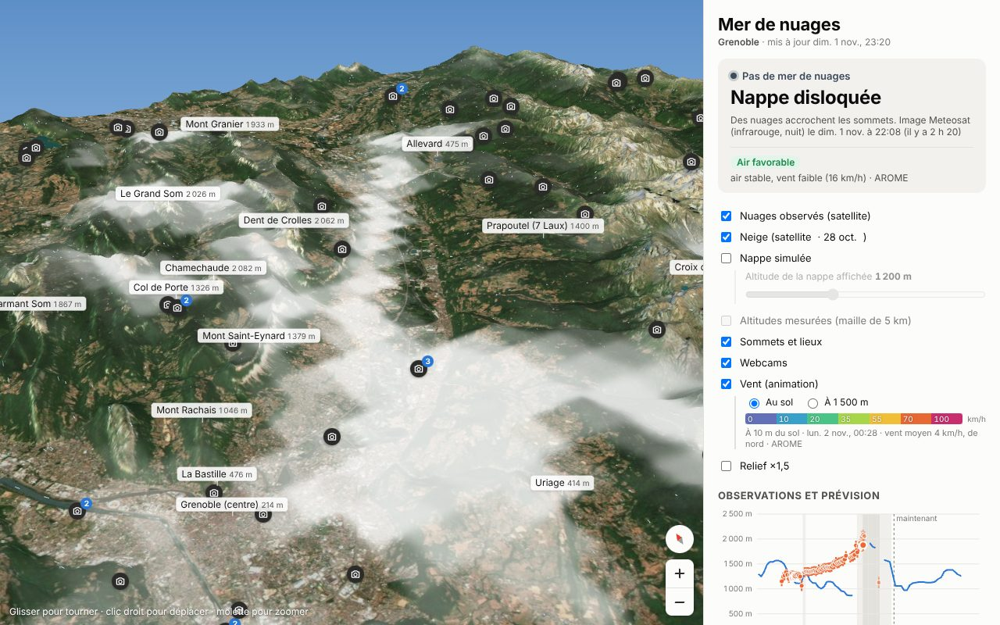
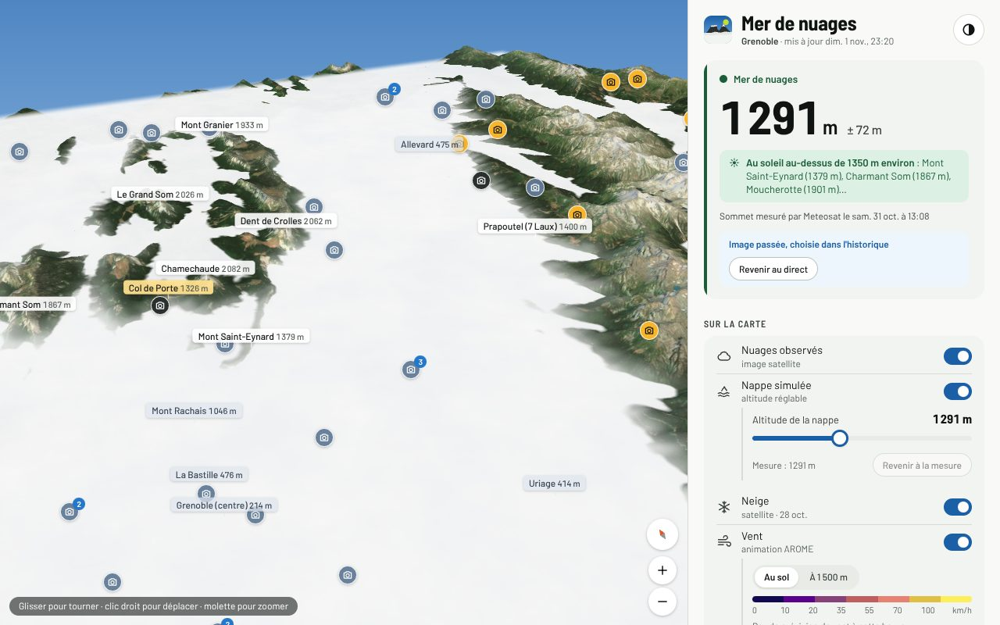
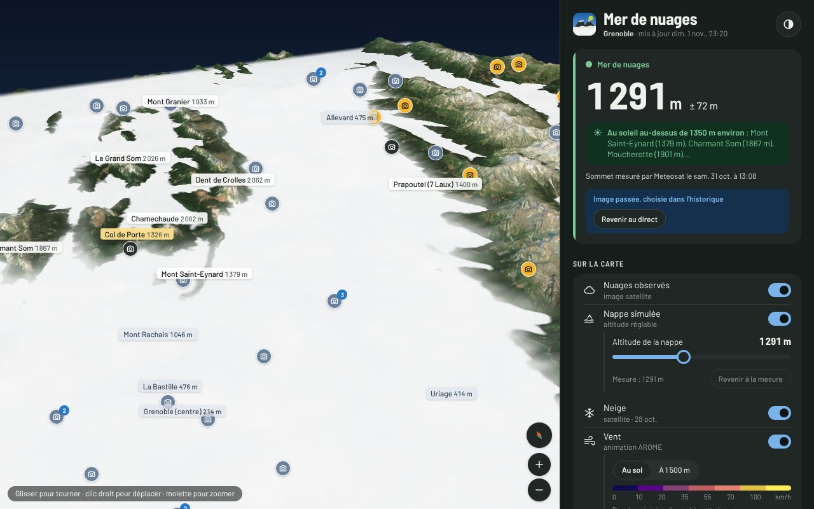
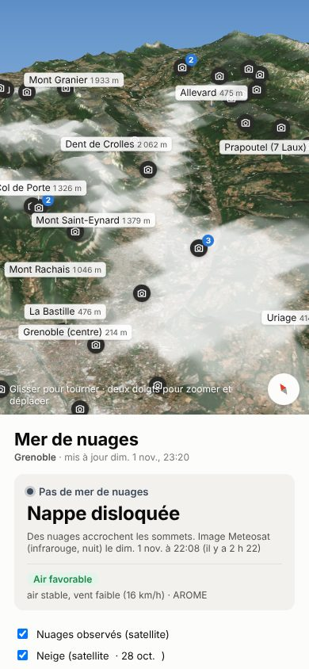
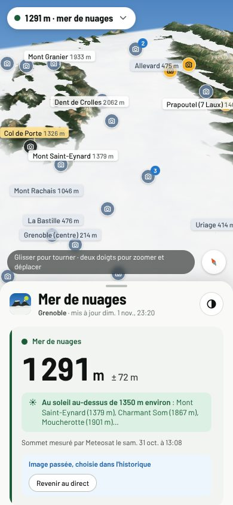
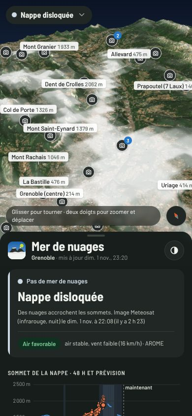

# Audit UX/UI — Mer de nuages

*Audit et refonte du 1er au 2 novembre 2026. Le design system qui en découle est décrit dans
[`design-system/README.md`](design-system/README.md).*

## Captures avant / après

| | Avant | Après |
|---|---|---|
| Ordinateur |  |   |
| Téléphone |  |   |

Les captures « après » en clair montrent une analyse passée avec une mer de nuages (31 oct., 13:08). Celles « avant »
et « après, sombre » montrent la situation au moment de l'audit : une nappe disloquée, de nuit.

## Méthode et référentiels

- **Revue experte** selon les 10 heuristiques de Nielsen, sur ordinateur (1280 × 800) et téléphone (390 × 844),
  en clair et en sombre, à la souris, au tactile et au clavier seul.
- **Accessibilité** : WCAG 2.2 niveau AA, avec la cible tactile minimale de 24 px (2.5.8) et celle de 44 px
  recommandée par Apple HIG et WCAG 2.5.5 pour les réglages. Test automatique avec **axe-core 4.10**
  (règles WCAG 2.0/2.1/2.2 A et AA, plus les bonnes pratiques).
- **Couleur et daltonisme** : simulation Machado (2009) et écarts en OKLab, avec `tools/verif_couleurs.py`
  (voir le [rapport](design-system/verif-couleurs.md)).
- **Pratiques actuelles** : tokens à trois niveaux, `light-dark()` et `color-scheme`, `prefers-reduced-motion`,
  unités `svh` et zones de sécurité sur mobile, polices hébergées sur le site avec `font-display: swap` et
  préchargement, manifeste d'application web (installation sur l'écran d'accueil), états de chargement et
  d'erreur explicites.

## Chiffres clés

| Mesure | Avant | Après |
|---|---|---|
| Violations axe-core (page principale) | 3 règles, 22 éléments (contraste ×8, cibles tactiles ×13, repère `main`) | **0** |
| Violations axe-core (éditeur de webcams) | non mesuré | **0** |
| Vérifications de couleurs (contrastes et daltonisme, 2 thèmes) | aucune ; l'échelle du vent arc-en-ciel échoue en protanopie | **0 échec**, dans les 2 thèmes |
| Sources de vérité pour les couleurs | 3 (style.css, éditeur, valeurs en dur dans app.js) | 1 (`web/ds/tokens.css`) |
| Couleurs hexadécimales dans les feuilles de style des pages | 108 (78 dans style.css, 30 dans l'éditeur) | **0** |
| Thème sombre | partiel (le panneau seulement, pas les contrôles de carte) | complet, avec un bouton pour basculer |
| Réponse visible sans faire défiler sur téléphone | non (l'état arrivait sous 62 % d'écran de carte) | oui (résumé flottant sur la carte) |

## Constats et suite donnée

Gravité : 🔴 bloque ou induit en erreur · 🟠 gêne réelle · 🟡 finition.

### Identité et cohérence visuelle

| # | Constat | Grav. | Référentiel | Suite |
|---|---|---|---|---|
| 1 | Pas d'identité : gris neutres, police système, logo générique ; rien ne dit « montagne » ni « Grenoble » | 🟠 | Esthétique et design minimaliste (H8) | ✅ Palette « Grelou » (ardoise, ciel, chartreuse, soleil, balise, sapin, brume), Barlow et Barlow Semi Condensed hébergées sur le site, logo de la Dent de Crolles, ton et microcopie |
| 2 | Trois définitions concurrentes des couleurs ; couleurs en dur dans la scène, la navigation, les étiquettes et l'éditeur | 🟠 | Cohérence et standards (H4) | ✅ Tokens uniques à trois niveaux ; composants `.ds-` ; l'éditeur utilise les mêmes fichiers |
| 3 | Pas d'échelle d'espacement, de taille de texte ni de rayon : valeurs au cas par cas | 🟡 | H4 | ✅ Échelles `--space-*`, `--text-*`, `--radius-*`, `--shadow-*`, `--dur-*` |

### Hiérarchie de l'information

| # | Constat | Grav. | Référentiel | Suite |
|---|---|---|---|---|
| 4 | Sur téléphone, la réponse (y a-t-il une mer de nuages, à quelle altitude ?) est sous la carte, hors de l'écran | 🔴 | Visibilité de l'état du système (H1) | ✅ Résumé flottant sur la carte (état, altitude) qui mène au détail ; panneau en « feuille » qui remonte sur la carte |
| 5 | La carte d'état donne une altitude mais pas la conséquence pratique : où aller pour être au soleil ? | 🟠 | Correspondance avec le monde réel (H2) | ✅ Nouveau conseil : « ☀ Au soleil au-dessus de 1 350 m environ : Mont Saint-Eynard, Charmant Som, Moucherotte… », calculé sur la mesure ± incertitude |
| 6 | Neuf cases à cocher à plat, de même poids, avant le graphique | 🟠 | Reconnaissance plutôt que rappel (H6), H8 | ✅ Calques regroupés dans une carte « Sur la carte » : interrupteurs avec pictogramme et sous-libellé ; réglages de la nappe affichés seulement quand elle est active ; sur téléphone, les calques passent après le graphique et les sommets |
| 7 | Une fois une analyse passée choisie dans le tableau, aucun moyen de revenir au direct, sauf à recharger la page | 🔴 | Contrôle et liberté de l'utilisateur (H3) | ✅ Bandeau « Image passée, choisie dans l'historique » avec un bouton **Revenir au direct** |
| 8 | Le texte « Méthode » et les 77 analyses allongent beaucoup le panneau | 🟡 | H8 | ✅ Sections repliables natives (`
`) : « Historique des analyses satellite » avec un compteur, « Comment ça marche ? » ; tableau défilant avec en-tête collant |
| 9 | Liste des 29 lieux toujours entière | 🟡 | H8 | ✅ Repliée à 10 lieux **centrés sur le bord de la nappe** (là où ça se joue), avec « Afficher les 29 lieux » |
| 10 | Pastilles « au-dessus · au niveau du bord · dans / sous la mer » longues, de largeur variable | 🟡 | H4 | ✅ « ☀ au soleil · ≈ au bord · ☁ dans la nappe », largeur fixe, alignées |

### Accessibilité

| # | Constat | Grav. | Référentiel | Suite |
|---|---|---|---|---|
| 11 | Contrastes insuffisants : date de mise à jour, badge d'air, notes (8 éléments) | 🟠 | WCAG 1.4.3 | ✅ Tous les textes à 4,5:1 ou plus, vérifiés par script dans les deux thèmes |
| 12 | Échelle du vent arc-en-ciel, reprise de Windy : verts et rouges de même clarté, ordre illisible pour 8 % des hommes | 🟠 | WCAG 1.4.1, bonnes pratiques de visualisation | ✅ Échelle « plasma » optimisée : luminosité croissante dans les 5 visions simulées ; graduations sous la barre |
| 13 | Pastilles de webcam de 22 px qui se chevauchent : cibles tactiles impossibles (13 éléments) | 🟠 | WCAG 2.5.8 | ✅ Pastilles de 24 px avec liseré ; celles qui se chevauchent sont masquées jusqu'au zoom, comme les noms de lieux ; toutes restent dans la liste |
| 14 | Lignes de réglage et boutons de 16 à 26 px de haut | 🟡 | WCAG 2.5.5, HIG 44 pt | ✅ Lignes de réglage de 44 px, entièrement cliquables ; boutons de 36 à 40 px |
| 15 | Pas de repère `main`, pas de lien d'évitement ; tableau sans légende ; lignes cliquables sans style de focus ni état annoncé | 🟠 | WCAG 1.3.1, 2.4.1, 2.4.7 | ✅ `<main>`, lien « Aller aux informations », `<caption>` réservé aux lecteurs d'écran, `aria-current` sur la ligne choisie, Entrée et Espace, anneau de focus partout (`--focus-ring`) |
| 16 | Vue 3D inutilisable au clavier | 🟠 | WCAG 2.1.1 | ✅ Le canevas prend le focus ; les flèches déplacent la vue (OrbitControls) ; les boutons nord et zoom restent disponibles |
| 17 | Graphique annoncé seulement par un titre générique | 🟡 | WCAG 1.1.1 | ✅ Résumé dynamique dans `aria-label` : dernière mesure, prochaine prévision |
| 18 | Animations permanentes (vent, nappe, pulsation, glissé de la caméra) même si l'utilisateur demande moins de mouvement | 🟠 | WCAG 2.3.3, `prefers-reduced-motion` | ✅ Vent coupé par défaut, nappe immobile, caméra sans glissé, durées à 0 |
| 19 | Le curseur d'altitude n'annonce pas sa valeur et ne montre pas où est la mesure | 🟡 | H1 | ✅ `<output for>`, repère de la mesure (`<datalist>`), « Mesure : 1 291 m » ; bouton « Revenir à la mesure » ou « à la prévision » selon le cas |

### États, robustesse, plateforme

| # | Constat | Grav. | Référentiel | Suite |
|---|---|---|---|---|
| 20 | En cas d'échec (réseau, WebGL absent, fichier manquant), « Chargement du relief… » reste affiché indéfiniment | 🔴 | Aider à reconnaître et corriger les erreurs (H9) | ✅ Message explicite (réseau ou WebGL) et bouton **Réessayer** ; message rassurant au-delà de 15 s |
| 21 | Chargement en texte brut | 🟡 | H1 | ✅ Écran de chargement aux couleurs du site : logo animé (nappe qui dérive), « On monte au-dessus des nuages… » |
| 22 | Astuce de navigation affichée en permanence, illisible sur la nappe blanche | 🟡 | H8 | ✅ Pastille sombre translucide, lisible partout ; effacée à la première manipulation et mémorisée |
| 23 | Pas de mode sombre pour les contrôles de carte ; pas de choix manuel du thème | 🟠 | Préférence utilisateur | ✅ Thème automatique, clair ou sombre, avec un bouton ; scène au crépuscule en sombre ; pas de flash au chargement ; `theme-color` adapté |
| 24 | Pas installable sur l'écran d'accueil ; icônes incohérentes | 🟡 | PWA | ✅ `manifest.webmanifest`, icônes 192 et 512 px et maskable régénérées depuis le logo |
| 25 | Police système : rendu différent selon l'appareil | 🟡 | H4 | ✅ Barlow hébergée sur le site (6 fichiers woff2, 140 Ko au total, dont 2 préchargés) |

## Chantiers suivants (non faits cette nuit)

Classés par rapport valeur/effort.

1. **Lien partageable avec état** (`?h=1350&analyse=…&cam=…`) : partager « regarde, ça passe au-dessus de 1 350 m »
   est l'usage social naturel de l'application.
2. **Alerte « mer de nuages demain matin »** : notification web (Push API) ou flux RSS/Atom alimenté par le
   workflow quand AROME prévoit une nappe avec une masse d'air favorable.
3. **Frise temporelle** sous le graphique : faire défiler les analyses de la journée comme une animation, et
   l'utiliser comme sélecteur à la place du tableau.
4. **Mode hors ligne** (service worker) : relief et texture (3,5 Mo) mis en cache après la première visite,
   données rafraîchies dès que le réseau revient. Bon gain au deuxième chargement sur la 4G des parkings de station.
5. **Poids de la première visite** : `texture.jpg` (2,2 Mo) et `relief.png` (1,3 Mo) pourraient passer en AVIF/WebP
   et en tuiles progressives ; three.js (≈ 650 Ko) pourrait être allégé par un tri des imports.
6. **Regroupement des webcams selon le zoom** (« 3 webcams ici ») plutôt que masquer les pastilles qui se
   chevauchent.
7. **Feuille glissante** sur téléphone (bottom sheet à poignée, deux crans) à la place du défilement de page.
8. **Vérification des couleurs en CI** : ajouter `python3 tools/verif_couleurs.py` à un workflow de contrôle des
   pull requests (pas au workflow de données, pour ne pas bloquer la publication).
9. **Tests de non-régression visuelle** : les captures de `docs/captures` se régénèrent avec
   `tools/screenshot.mjs` ; elles pourraient être comparées automatiquement.
